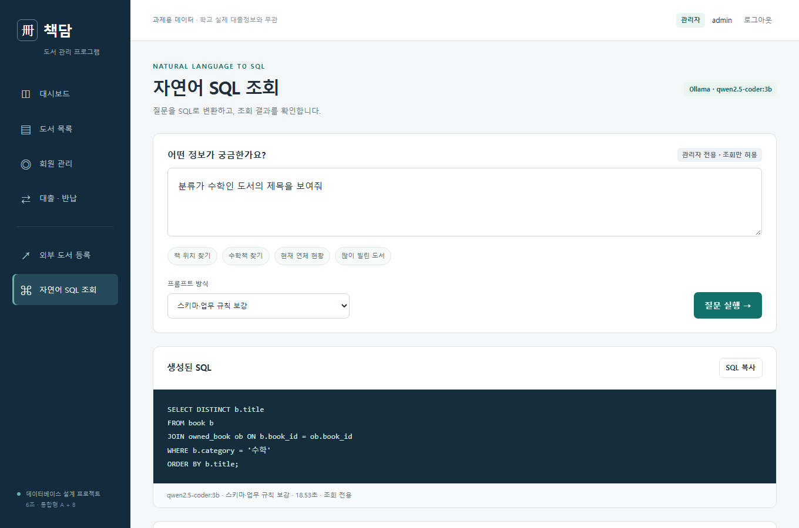

# 책담 | 데이터베이스 설계 Term Project 6조

도서 등록부터 대출·반납까지 처리하는 Flask/MySQL 웹 앱과 로컬 Ollama 기반 자연어 SQL 조회를 한 프로그램에서 실행합니다. 안내서의 통합형(확장형 A+B)에 해당합니다.

도서 서지정보는 국립중앙도서관 API로 조회할 수 있습니다. 공주대 도서관 소장자료 검색에서 확인한 ISBN을 검색어로 사용할 수 있습니다. 초기 데이터와 앱의 소장 수량·대출 정보는 과제용입니다.

## 1. Windows에서 실행

Python 3.11 이상과 실행 중인 MySQL 8.0.16 이상이 필요합니다. 저장소를 내려받은 뒤 프로젝트 폴더에서 PowerShell로 실행합니다.

```powershell
git clone https://github.com/biny03/Chaekdam-library.git
cd Chaekdam-library
```

```powershell
python -m venv .venv
.\.venv\Scripts\python.exe -m pip install -r requirements.txt
Copy-Item .env.example .env
notepad .env
```

`.env`에서 MySQL 서버의 `DB_HOST`와 `DB_PORT`를 확인하고, 앱 계정과 조회 계정의 비밀번호(`DB_PASSWORD`, `DB_READ_PASSWORD`)를 각각 정합니다. MySQL 관리자의 비밀번호는 초기화할 때 별도로 입력합니다. 기존 DB와 이름이 겹치면 새 `DB_NAME`과 새 계정 이름을 정합니다. `SECRET_KEY`도 길고 임의의 값으로 바꿉니다.

```powershell
.\.venv\Scripts\python.exe scripts/init_db.py --seed
.\.venv\Scripts\python.exe run.py
```

브라우저에서 [http://127.0.0.1:5000](http://127.0.0.1:5000)을 엽니다. `--seed`는 모든 테이블이 비어 있을 때 한 번 실행합니다. 재실행할 때는 `run.py`만 사용합니다.

새 이용자는 로그인 화면에서 **회원가입**을 눌러 이름, 연락처, 아이디와 비밀번호를 등록합니다. 가입 후 같은 아이디로 로그인하면 도서를 검색하고 본인의 대출 내역을 볼 수 있습니다.

| 역할 | 아이디 | 초기 샘플 비밀번호 |
| --- | --- | --- |
| 관리자 | `admin` | `admin123!` |
| 회원 | `member01` | `member123!` |

MySQL의 `Access denied` 오류가 나면 서버 주소, 포트, 사용자 이름과 비밀번호를 확인합니다. `init_db.py`는 기존 MySQL 계정의 암호를 변경하지 않습니다. `3306` 연결에 실패하면 MySQL 서비스가 실행 중인지 먼저 확인합니다. 로컬 초기화의 계정 호스트는 `127.0.0.1`입니다.

## 2. 발표 PC에서 자연어 조회 준비

책담과 MySQL을 실행할 PC에 [Windows용 Ollama](https://ollama.com/download/windows)를 설치하고 시작 메뉴에서 실행합니다. 새 PowerShell 창에서 다음 두 명령을 실행합니다.

```powershell
ollama pull qwen2.5-coder:3b
ollama list
```

목록에 모델 이름이 나오면 준비된 것입니다. 모델 파일은 약 1.9GB이므로 발표 전에 받으세요. 기본 설정은 `LLM_PROVIDER=ollama`, `OLLAMA_MODEL=qwen2.5-coder:3b`입니다. 모델을 받은 뒤에는 로컬 조회에 인터넷이나 API 키가 필요 없습니다. 설정을 바꾸면 책담을 다시 시작합니다.

서버도 다른 PC로 옮길 경우 해당 PC에서 1절과 모델 설치를 진행합니다. 서버를 개인 노트북에서 실행하고 발표용 PC는 브라우저만 사용할 경우, 같은 네트워크에서 노트북의 로컬 서버를 종료한 뒤 아래 명령으로 시작합니다.

```powershell
.\.venv\Scripts\python.exe -m flask --app run:app run --host 0.0.0.0 --port 5000
```

발표용 PC 브라우저 주소창에 `http://노트북의-IPv4-주소:5000`을 입력합니다. 노트북 IP는 `ipconfig`로 확인합니다. MySQL·Ollama 연결 주소는 노트북의 루프백으로 둡니다.

 관리자 로그인 → **자연어 SQL 조회** → **보강**을 선택하고 “분류가 수학인 도서의 제목을 보여줘”를 입력합니다. SQL과 표가 표시되는지 확인하세요. 초기 자료라면 《공간을 읽는 기하학》과 《생활 속 통계 이야기》가 나옵니다.



## 외부 API 선택 설정

OpenAI로 전환할 때는 `LLM_PROVIDER=openai`를 설정합니다.

| 환경변수 | 역할 | 사용 방법 |
| --- | --- | --- |
| `NL_API_KEY` | 국립중앙도서관 ISBN 서지정보 | [국립중앙도서관 Open API](https://www.nl.go.kr/NL/contents/N31101010000.do)에서 인증키를 발급받아 입력 |
| `OPENAI_API_KEY` | 자연어 질문에서 SQL 생성 | [OpenAI API 개발자 가이드](https://developers.openai.com/api/docs/quickstart)에 따라 키를 발급받아 입력 |
| `OPENAI_MODEL` | 비교 평가에 사용할 모델 | 기본값 `gpt-4.1-mini`, 계정에서 사용할 수 있는 모델 ID로 변경 가능 |

키는 로컬 `.env`에 저장한 뒤 서버를 다시 시작합니다. API 키를 채팅, 코드, 보고서, GitHub에 넣지 않습니다. 일반 도서 등록, 대출·반납, 회원 관리에는 키가 필요 없습니다.

관리자 메뉴 **외부 도서 등록**에서 ISBN이나 제목으로 찾고, 결과를 선택해 실제 출판일과 분류를 확인한 후 저장합니다. API의 출판예정일은 화면에서만 참고합니다. 소장 도서가 필요한 경우 도서 상세에서 별도 관리번호를 추가합니다.

RISS 상세 페이지에 국립공주대학교 도서관이 소장기관으로 표시된 도서입니다. 인증키를 설정한 뒤 아래 ISBN으로 시연할 수 있습니다.

| 도서 | ISBN | 소장기관 출처 |
| --- | --- | --- |
| 인체발생학 10판 | `9791159430008` | [RISS 자료 상세](https://m.riss.kr/search/detail/DetailView.do?control_no=943e1b52ffce77aaffe0bdc3ef48d419&p_mat_type=d7345961987b50bf) |
| 집단상담의 이론과 실제 | `9788999706325` | [RISS 자료 상세](https://m.riss.kr/search/detail/ssoSkipDetailView.do?control_no=5adede0f42caadf6ffe0bdc3ef48d419&p_mat_type=d7345961987b50bf) |
| 안녕! 사회주의 | `9788991402263` | [RISS 자료 상세](https://m.riss.kr/search/detail/DetailView.do?control_no=0141c904180dd323ffe0bdc3ef48d419&p_mat_type=d7345961987b50bf) |

관리자 메뉴 **자연어 SQL 조회**에서 질문과 프롬프트 방식을 선택합니다. 서버가 선택한 모델에서 SQL을 받고, 검증 통과 후 제한된 MySQL 조회 계정으로 실행합니다. 생성된 SQL과 조회 결과가 화면에 표시됩니다. 질문에 실제 개인정보를 넣지 않습니다.

## 3. 시연 순서

1. 관리자로 로그인해 도서 번호와 개별 도서 관리번호의 차이를 설명합니다. 첫 번째 테스트 도서는 `B001`, `B002` 두 권이 등록되어 있습니다.
2. 테스트회원08에게 `B002`를 대출한 뒤, 이미 대출 중인 책을 다시 대출해 거절 메시지를 확인합니다. 반납하면 대출 가능 수량이 복구됩니다.
3. 회원으로 다시 로그인해 본인 대출 이력만 표시되는지 확인합니다.
4. API 키 설정 후 ISBN 검색 결과의 제목과 저자를 확인하고 도서를 등록합니다. ISBN이 같은 책은 중복 등록되지 않습니다.
5. 자연어 메뉴에서 “현재 연체 중인 회원의 이름과 도서 제목을 알려줘”를 실행합니다. 현재 연체는 미반납이면서 반납 예정일이 기준일보다 앞선 대출입니다.

구현에서 사용하는 대출 기준은 기본 **동시 3권, 대출일에서 14일 후 반납**입니다. 과제 시연 기준이며 `MAX_LOANS`, `LOAN_DAYS`로 변경할 수 있습니다. 미반납 대출이나 연체 판단 단위는 소장 도서 한 권입니다.

## 4. 평가 재현

비교용 DB는 별도 이름으로 만들고 `REFERENCE_DATE=2026-11-23`을 설정한 다음 `init_db.py --seed`를 한 번 실행합니다. 질문 12건을 난이도별 4건으로 나눴습니다. 동일한 샘플과 기준일에서 기본 스키마 프롬프트와 업무 규칙을 보강한 프롬프트를 비교합니다.

```powershell
.\.venv\Scripts\python.exe scripts/evaluate_nl2sql.py --reference-only
.\.venv\Scripts\python.exe scripts/evaluate_nl2sql.py --output-dir evaluation/results/live-comparison
```

첫 명령은 정답 SQL만 실행합니다. 두 번째 명령은 선택한 모델을 24회 호출하며 결과·정확도·오류를 JSON과 CSV로 저장합니다. 순서가 의미 있는 질문은 순서까지 비교하고, 나머지는 중복 건수를 보존해 비교합니다. SQL 실행에 성공해도 정답과 결과가 다르면 의미 오류로 기록합니다. 실제 실행 결과를 보고서 평가 절에 옮겨 적고 틀린 질문의 SQL을 함께 분석합니다.

## 5. 코드 구조

| 경로 | 설명 |
| --- | --- |
| `sql/schema.sql` | 대출 신청을 포함한 6개 테이블, PK·FK·UNIQUE·CHECK |
| `sql/business_queries.sql` | 요구사항별 핵심 SQL 예시 |
| `library_app/services.py` | 대출 정책, 반납 트랜잭션, 등록·검색 |
| `library_app/__init__.py` | 웹 API, 로그인 세션, 관리자/회원 권한 검사 |
| `library_app/external_books.py` | 국립중앙도서관 API 호출과 응답 변환 |
| `library_app/nl2sql.py` | Ollama·OpenAI 호출, SQL 검증, 결과 제한 |
| `library_app/templates/`, `library_app/static/` | 브라우저 화면 |
| `docs/requirements_sql_mapping.md` | 기능, 코드, SQL의 대응 관계 |
| `evaluation/questions.json` | 질문, 정답 SQL, 비교 기준 |
| `tests/` | DB 업무 규칙, HTTP 권한, 외부 API 응답 변환, NL2SQL 검사 |

제출용 GitHub에는 이 폴더의 실행 코드와 README를 올립니다. `.env`, DB 암호, 실제 학생 정보, 실제 API 키, 테스트 DB 데이터 디렉터리는 올리지 않습니다. 정답 SQL 검증 결과와 실제 모델 평가를 보고서에서 구분합니다. 팀원별 기여 기록과 GitHub 주소는 제출본에 실제 내용으로 채웁니다.


## 회원 도서 검색과 대출 신청

도서 목록의 검색창에 ‘지금 빌릴 수 있는 수학책 보여줘’처럼 입력한다. 로컬 Ollama가 검색 필드를 정하고 서버가 실제 DB에서 일치하는 도서를 조회한다. 모델 연결 실패 시에는 입력한 문구를 일반 검색에 사용하고 화면에 안내한다. 빈 검색은 전체 목록이다.

회원은 목록의 대출 신청을 누른 뒤 원하는 소장본을 선택한다. 신청은 관리자 대출·반납 메뉴의 신청 내역에서 승인하거나 거절한다. 승인 시 현재 대출 가능 여부와 회원의 한도·연체를 다시 검사하고 대출을 생성한다. 승인 전에는 책을 예약하지 않는다. 같은 소장본의 다른 신청은 실제 대출이 이루어지면 거절 처리된다.

기존 설치를 갱신할 때는 앱을 종료하고 기존 설정으로 `python scripts/init_db.py`를 실행해 loan_request 테이블을 추가한 뒤 다시 시작한다. 기존 자료가 있는 DB에서는 --seed를 사용하지 않는다.
